<div align="center">

<picture>
  <source media="(prefers-color-scheme: dark)" srcset="docs/media/logo-night.png">
  
</picture>

# Moon Kiln TV

**A home screen for my TV, in Moon Kiln's own look.**

A custom Android TV launcher that replaces the Google TV home screen on a OnePlus TV Y Series. The PS5 is one button away, the shop's day sits right beside it, and a Mac mini on the same Wi-Fi feeds it the rest: orders still to fulfil, the latest sale, a whole page on how the shop is doing. A Claude Code session on the mini answers on the big screen, a line typed on my phone can take over whatever is playing to tell the house something, and when nobody is watching, the screensaver flips through polaroids of pieces from the shelf.

*Built for a 32-bit TV with 1 GB of RAM, so every frame and every megabyte is counted.*


<br>

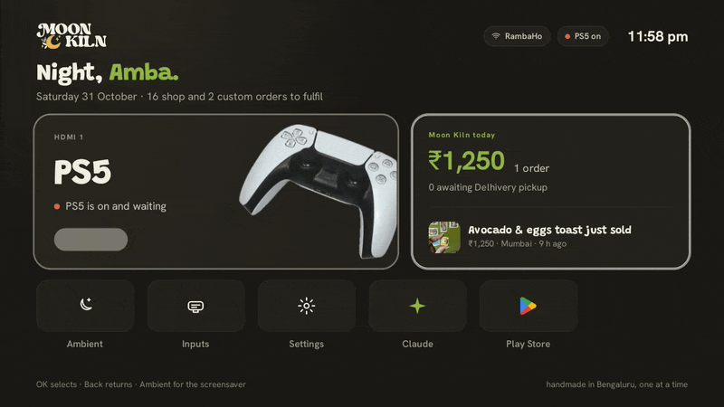

</div>

---

[Moon Kiln](https://moonkiln.com) is my one-person clay studio in Bengaluru, and my TV is mostly a PS5 screen. The stock home screen was a wall of recommendations I never used, holding on to memory this TV does not have to spare. So I made my own: the PS5 first, the day's orders right next to it, and the shop's numbers, Claude and the house announcements a click away. The mini already runs the shop's data warehouse and Claude Code, so it does the heavy lifting and the TV only has to draw.

## The screens

Drawn to be read from across the room, at 1280x720, in the kiln palette: ink and cream with a little green and sun yellow.

<table align="center">
  <tr>
    <td align="center" width="50%">
      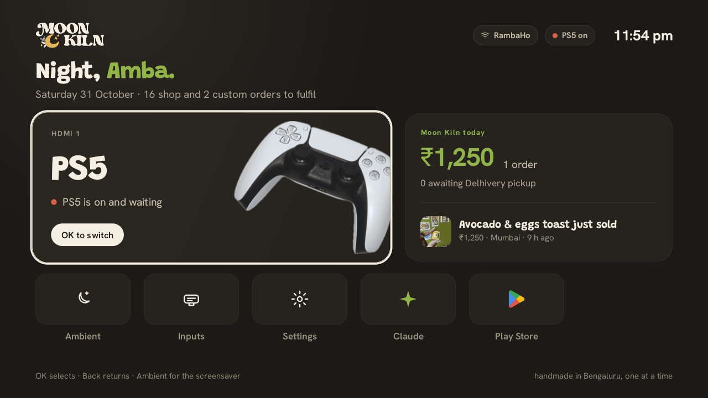<br>
      <sub><b>Home.</b> PS5 first, today's sales beside it, five tiles below.</sub>
    </td>
    <td align="center" width="50%">
      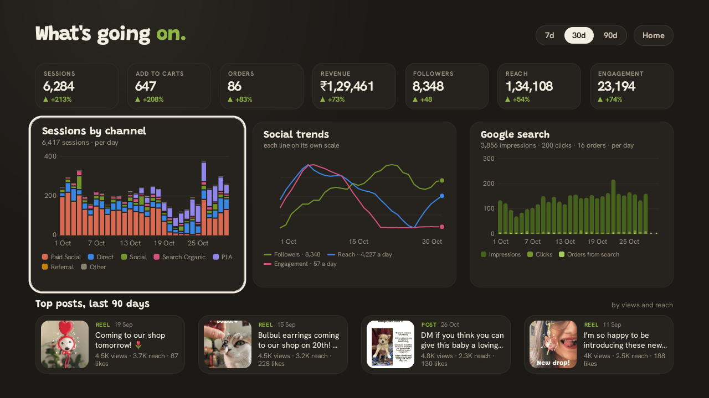<br>
      <sub><b>What's going on.</b> The shop's numbers on one page, straight from the warehouse.</sub>
    </td>
  </tr>
  <tr>
    <td align="center">
      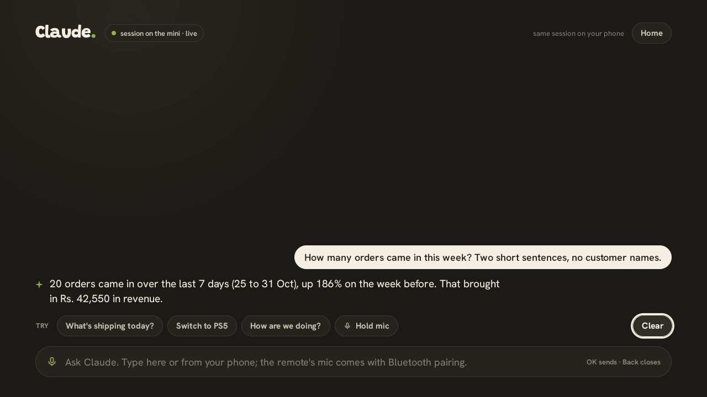<br>
      <sub><b>Claude.</b> The session on the mini, answering on the big screen.</sub>
    </td>
    <td align="center">
      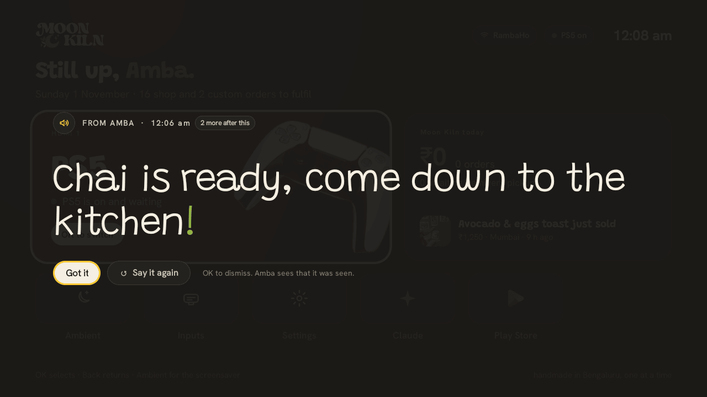<br>
      <sub><b>Tell the house.</b> An announcement over whatever is on, the PS5 included.</sub>
    </td>
  </tr>
  <tr>
    <td align="center">
      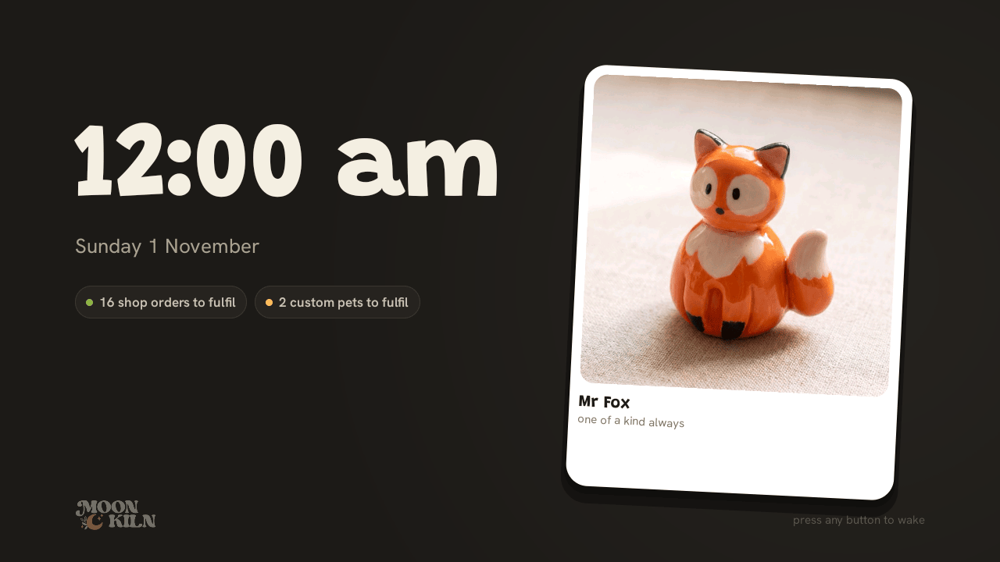<br>
      <sub><b>Ambient.</b> The screensaver: a clock, what's left to fulfil, a polaroid.</sub>
    </td>
    <td align="center">
      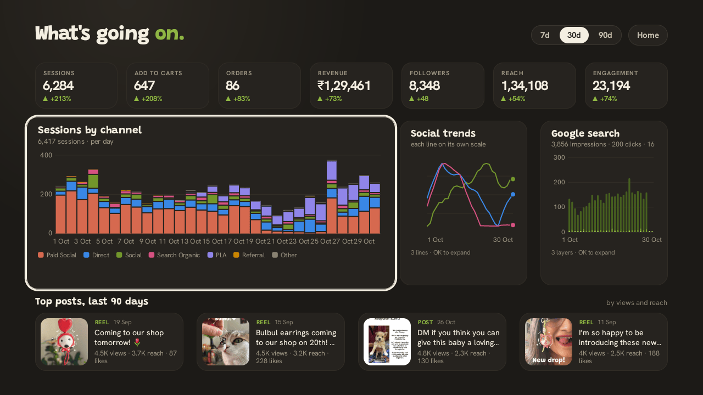<br>
      <sub><b>A chart, opened.</b> OK widens a chart, Back puts it back.</sub>
    </td>
  </tr>
</table>

### In motion

<table align="center">
  <tr>
    <td align="center" width="50%">
      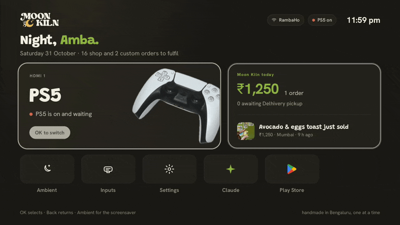<br>
      <sub><b>Opening the numbers.</b> The count-up, then a chart widening.</sub>
    </td>
    <td align="center" width="50%">
      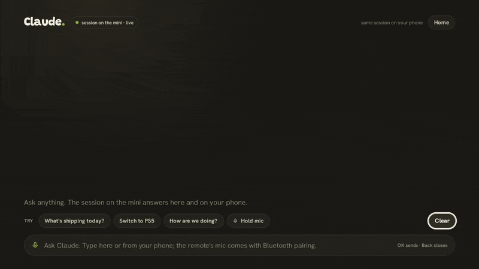<br>
      <sub><b>Asking Claude.</b> A question from the phone, the answer word by word.</sub>
    </td>
  </tr>
  <tr>
    <td align="center">
      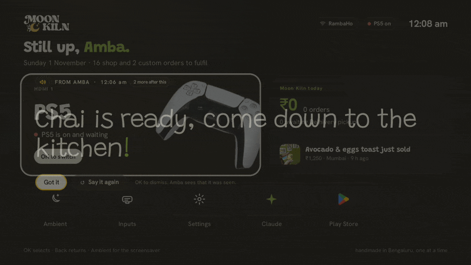<br>
      <sub><b>An announcement.</b> The chime, the scrim, the words lighting up.</sub>
    </td>
    <td align="center">
      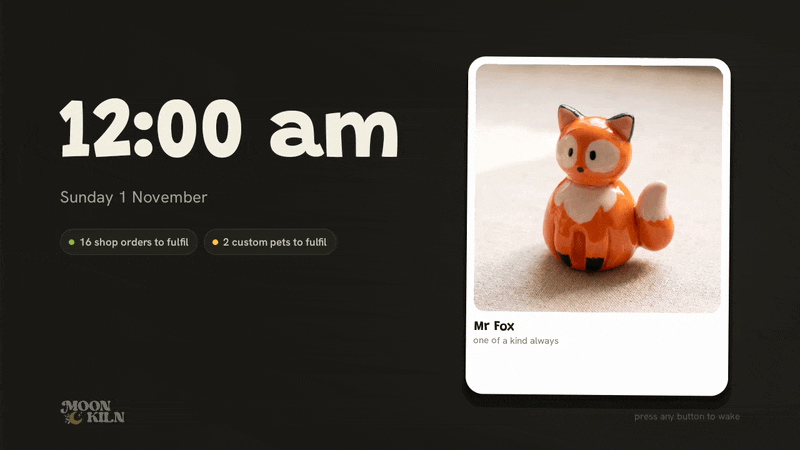<br>
      <sub><b>Ambient.</b> The polaroid sways, the photo changes.</sub>
    </td>
  </tr>
</table>

<div align="center"><sub>Captured on the TV itself on 31 Oct and 1 Nov 2026 with <code>screencap</code> and <code>screenrecord</code> over adb. The Claude GIF skips the thinking time, since <code>screenrecord</code> only writes a frame when the screen changes. The announcement went out without the voice (it was past midnight), so the words light at reading pace; with the voice they light as they are said.</sub></div>

## What it does

- **PS5 first.** The big card switches the TV to HDMI 1, and that switch wakes the PS5 from rest over HDMI-CEC. Its dot reads the PS5's power state from the HDMI signal, and the remote's input key goes straight there.
- **Moon Kiln today.** Orders and revenue so far today, what is waiting for the Delhivery pickup, open orders split into shop and custom, and the latest sale with a photo of the piece. When the mini is away it keeps the last good answer and marks it stale.
- **What's going on.** The shop over 7, 30 or 90 days on one page: seven tiles with the change on the period before, sessions by channel, social trends, Google search, and the top posts of the last 90 days.
- **Claude on the TV.** The TV never runs Claude. A Claude Code session on the mini answers here word by word, and every tool call shows as a one-line marker ("tv · switched to HDMI 1"). The same session is open on my phone through Remote Control, so a question can start on either.
- **Tell the house.** A line typed on a phone page, or sent by Claude, gets a local [Kokoro](https://github.com/thewh1teagle/kokoro-onnx) voice on the mini. The TV chimes, dims whatever is on, and lights each word as it is said. Got it or Say it again, and the sender sees that it was seen.
- **New order toast.** A small card slides in over anything, the PS5 picture too, when an order comes in.
- **Ambient.** Also the system screensaver: a big clock, the date, what is left to fulfil, and polaroids of twelve pieces drifting by.
- **Stays out of the PS5's way.** A cold boot lands on the launcher without waking the PS5, and a guard deals with the TV snapping back to the PS5 after a Home press. The how is under [TV quirks](#tv-quirks).

## Build and install

> [!IMPORTANT]
> This is made for one TV and one shop. The HDMI input ids, the CEC workarounds and the endpoint's warehouse queries all assume a OnePlus TV Y Series (MediaTek MT5621, Android TV 11) and Moon Kiln's own data. On anything else, read it as a reference to borrow from rather than something to install as is.

### The launcher

Everything runs from the command line with the Gradle wrapper and the JDK inside Android Studio, so no system `java` or `gradle` is needed.

```sh
export JAVA_HOME="/Applications/Android Studio.app/Contents/jbr/Contents/Home"
./gradlew :app:assembleRelease

adb connect 192.168.0.11:5555
adb -s 192.168.0.11:5555 install -r app/build/outputs/apk/release/app-release.apk
```

The build reads `local.properties` (not in git):

| Key | Meaning |
| --- | --- |
| `sdk.dir` | The Android SDK, e.g. `/Users/<you>/Library/Android/sdk` (platform android-36, build-tools 36.0.0). |
| `mk.todayToken` | The mini's bearer token. Becomes a BuildConfig field. |
| `mk.miniBase` | The mini's address. Default `http://192.168.0.14:9470`. |

The release build is minified with R8 and signed with the debug key: this is a sideloaded launcher, not a Play upload.

> [!TIP]
> Always put the release build on the TV. The debug build is 24 MB and janks on this chip.

### First time on a TV

The grants the launcher needs, once per install with a new signing key (adb, no dialogs on this set):

```sh
adb -s 192.168.0.11:5555 shell appops set com.moonkiln.tv SYSTEM_ALERT_WINDOW allow   # the toast and announcements over the PS5 picture
adb -s 192.168.0.11:5555 shell pm grant com.moonkiln.tv android.permission.ACCESS_FINE_LOCATION   # the Wi-Fi name on the pill, needs location on too
adb -s 192.168.0.11:5555 shell settings put secure screensaver_components com.moonkiln.tv/.ambient.AmbientDream
adb -s 192.168.0.11:5555 shell settings put secure screensaver_enabled 1
```

Then make it the home screen:

```sh
adb -s 192.168.0.11:5555 shell cmd package set-home-activity com.moonkiln.tv/.MainActivity
adb -s 192.168.0.11:5555 shell pm uninstall --user 0 com.google.android.tvlauncher
adb -s 192.168.0.11:5555 shell settings put secure tv_user_setup_complete 0
```

On this build Home keeps going to the Google launcher until that package is gone for the user, and the last line stops the TV jumping to Live TV (and waking the PS5) on a cold boot. Both are explained under [TV quirks](#tv-quirks), and [the removal list](#removed-apps) has everything else that came off and how to bring it back.

### The mini

```sh
cd mini && zsh ./install.sh
```

Copies the endpoint to `~/Library/Application Support/mk-tv-today/`, creates the bearer token if there is none, and loads it as the launchd agent `com.moonkiln.tv-today`. Re-run it after editing the server.

### Claude on the TV

```sh
claude-on-tv/start.sh
```

Starts the Claude Code session inside tmux as `cc-claude-on-tv` with Remote Control on. Its hooks post to the mini's bridge, and its own [CLAUDE.md](claude-on-tv/CLAUDE.md) carries the TV rules: what it may do, and what needs a yes first.

### Requirements

- The TV: Android TV 11 (API 30), `armeabi-v7a`, network debugging on.
- Android Studio 2026.1 (for its JDK) and the Android SDK, platform 36.
- A Mac on the same network for the endpoint, with Python and DuckDB (the warehouse's venv), plus tmux and Claude Code for the Claude screen and Kokoro for the announcement voice.

> [!NOTE]
> The endpoint only answers the home network, the Tailscale range and loopback, and everything except `/health` needs the bearer token.

## Remote controls

| Button | What it does |
| --- | --- |
| <kbd>OK</kbd> | Select. On the PS5 card, switch to HDMI 1. On a chart, widen it. On an announcement, press the focused button. |
| <kbd>Back</kbd> | Put a widened chart back, otherwise go home. |
| <kbd>Input</kbd> | Straight to the PS5. |
| Mic or search key | Open Claude. The mic shows listening, then points to the phone until the remote is paired over Bluetooth. |
| <kbd>◀</kbd> <kbd>▶</kbd> on an announcement | Move between Got it and Say it again. |
| Any button in ambient | Wake up. |

## How it works

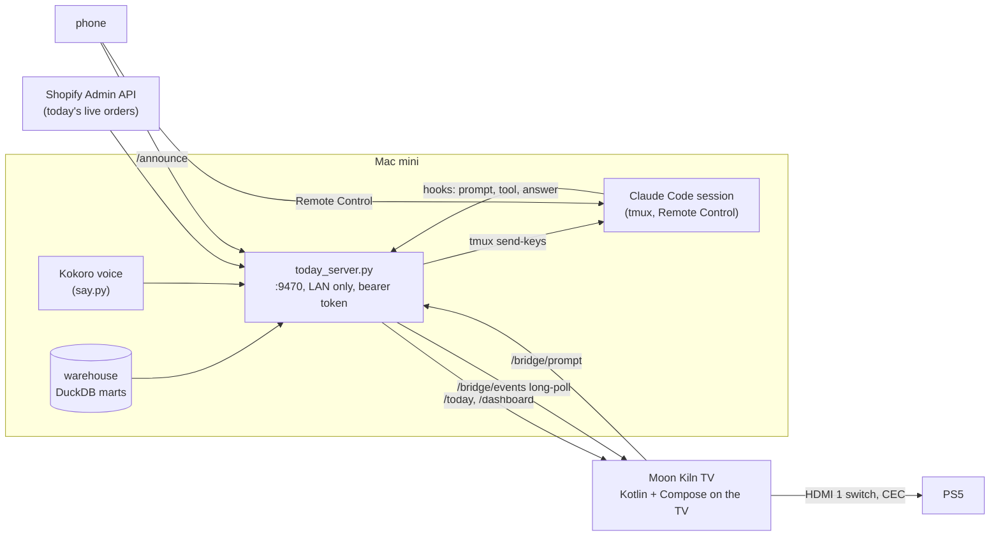

The TV does as little as it can. The mini computes every number server side, caches the answers (a minute for today, ten for the dashboard) and reads the warehouse read-only for the milliseconds a query takes, so the nightly rebuild is never blocked. The launcher polls `/today` for the day (a new latest sale is what brings up the order toast) and long-polls one bridge for everything else live: Claude's prompts, tool calls and answers, and announcements. A prompt from the TV is typed into the tmux session with `send-keys`, so it is no different from one typed at the keyboard.

<details>
<summary><b>Code layout</b></summary>
<br>

- `app/`: the launcher, Kotlin plus Jetpack Compose (foundation only, no material), minSdk 30, targetSdk 30, `armeabi-v7a` only. The design is the canvas "Moon Kiln TV Launcher" (Linear MOO-637); every pixel number in the code comes from it.
  - `ui/`: the kiln palette, the two bundled variable fonts (Grandstander and Hanken Grotesk, OFL, in `licences/`), the one easing, and `FocusTile` (focus pop, ring, press).
  - `home/`: the home screen (top bar, greeting, PS5 tile, today card, apps row, hint strip), the installed apps query, the Inputs page.
  - `analytics/`: the "What's going on" page with its three Canvas charts.
  - `ambient/`: ambient mode, used inside the launcher and as the system screensaver (`AmbientDream`). The twelve photos are 600 px hero shots in `assets/photos/`.
  - `toast/`: the new order toast, an overlay window of plain views so it shows over the PS5 picture.
  - `data/`: the mini client, the today and dashboard repositories (last good answer kept, stale badge when the mini is away), a tiny image loader.
  - `tv/`: TvInputManager helpers (PS5 power from the HDMI signal state, the passthrough switch) and the network pill.
  - `claude/`: the Claude screen. `announce/`: the announcement overlay.
  - `StartReceiver`: starts the process after a boot or an update, so the bridge listener (announcements, the order toast) runs even when the TV comes up on HDMI and nobody presses Home.
- `mini/`: `today_server.py` (the endpoint and the bridge), `say.py` (the announcement voice), the phone page in `announce/`, the launchd plist and `install.sh`.
- `claude-on-tv/`: the Claude Code session's folder: its CLAUDE.md, the hooks in `.claude/settings.json`, `bridge_hook.py` and `start.sh`.

The composition locks density to one pixel per dp (`KilnRoot`), so the canvas's 1280x720 pixel sizes apply as written on the 213 dpi panel. Only transform and opacity animate; durations honour the TV's animator scale (zero means no motion).

House rule: no em-dashes anywhere in this repo. Linear project: "Moon Kiln TV launcher" (P-MOO-25).

</details>

<details>
<summary><b>The mini endpoint</b> (<code>mini/today_server.py</code>)</summary>
<br>

Serves on port 9470, LAN only (home network, Tailscale range and loopback; anything else gets 403 before the token check) and behind a bearer token (`/health` is open).

| Endpoint | What it serves |
| --- | --- |
| `GET /today` | Orders and revenue today, pieces and shipments awaiting Delhivery pickup, open orders still to fulfil split into shop and custom (custom = tagged `mk-custom` or a product type starting with "Custom"), and the latest sale (title, amount, city, time, a 160 px JPEG). Warehouse marts plus a live Shopify Admin API read for what the nightly rebuild cannot know yet. Cached one minute. |
| `GET /dashboard?days=7\|30\|90` | The "What's going on" page, computed server side: seven tiles with the change against the previous period (followers as an absolute change), sessions by channel group per day (weekly buckets for 90), the social lines (Instagram plus Facebook, Pinterest and YouTube followers carried back before their first snapshot; reach and engagement as 7-day averages, YouTube views and reactions included), Google web search impressions and clicks with orders from search (last touch), and the top four posts of the last 90 days. Cached ten minutes. |
| `GET /thumbs/<media id>.jpg` | A post thumbnail from the warehouse thumbs folder. |
| `GET /bridge/events?since=N&wait=25` | What the TV long-polls: Claude events, announcements, the session status. |
| `POST /bridge/prompt` | Types a prompt into the tmux session. 503 when the session is not running. |
| `POST /announce` | Sends an announcement. `GET /announce/` is the phone page, `GET /announce/list` what it reads. |

It reads `~/Library/Application Support/mk-ig-metrics/ig.duckdb` and `raw_youtube.duckdb` read-only for the milliseconds a query takes, so the nightly dbt writer is never blocked; if dbt holds a file, the last good answer is served with `"stale": true`. Money is `net_sales`, formatted with Indian grouping.

The installer copies the server to `~/Library/Application Support/mk-tv-today/` (launchd children cannot run from the iCloud-synced Documents folder), creates the token at `~/Library/Application Support/mk-airbyte/secrets/mk-tv-today-token` if missing, and loads the agent `com.moonkiln.tv-today` (log `~/Library/Logs/mk-tv-today.log`). It runs on the warehouse venv's Python, which has the matching DuckDB. The launcher reads the same token from `mk.todayToken` in `local.properties` at build time.

```sh
curl -H "Authorization: Bearer <token>" http://192.168.0.14:9470/today
curl -H "Authorization: Bearer <token>" "http://192.168.0.14:9470/dashboard?days=30"
```

</details>

<details>
<summary><b>Claude on the TV, in detail</b></summary>
<br>

The TV never runs Claude. A Claude Code session lives on the mini in `claude-on-tv/`, started by `start.sh` inside tmux as `cc-claude-on-tv` with Remote Control on, so my phone attaches to the same session. The launcher's Claude tile (and the remote's mic keys) open the Claude screen, built to Claude.dc.html. The bridge is part of the mini server (same port, same token):

- The session's hooks (`claude-on-tv/.claude/settings.json` running `bridge_hook.py`) post one event per prompt (`prompt`), per tool call (`tool_start` and `tool_done`, with one-line markers such as "tv · switched to HDMI 1" or "mini · today's numbers") and per answer (`text`, the whole message at Stop; the TV reveals it word by word at 55 ms a word). Session start and end post `status`.
- `GET /bridge/events?since=N&wait=25` is what the TV long-polls while the Claude screen is open; it also carries the status (live, working, listening, offline) and whether the tmux session exists.
- `POST /bridge/prompt` types a prompt into the tmux session with `tmux send-keys` and presses Enter. It answers 503 when the session is not running.
- Claude's housekeeping tools (ToolSearch, the to-do list) never show on the TV, and a tool the hook does not know shows by name only, never its raw input.
- After the mini server restarts, a running session reads as live, not offline, until its next status event.

The remote's microphone needs Bluetooth pairing before voice can work (the remote is infrared only until then); the mic keys and the "Hold mic" pill show the listening state and then point to the phone.

</details>

<details>
<summary><b>Tell the house, in detail</b></summary>
<br>

Built to Announce.dc.html, AnnouncePhone.dc.html and AnnounceFlow.dc.html (Linear MOO-644). The mini does the heavy part and the TV only draws and plays.

- `POST /announce {text, from, voice, wake}` on the mini (same token) renders the voice with Kokoro through the Jarvis venv (`mini/say.py`; the voice is the one-line setting `MK_ANNOUNCE_VOICE`, default `af_heart`, deliberately not Jarvis's `bm_george`; about three seconds for a sentence), wakes the TV over adb when asked and it is asleep, pushes one `announce` event on the bridge, and keeps the receipts (`/announce/<id>/shown` and `/seen`, posted by the TV). `GET /announce/` is the phone page (token pasted once, kept on the phone); `GET /announce/list` is what it reads. Claude in the claude-on-tv session can announce with the same POST, shown as the marker "announce · on the TV".
- The launcher's bridge listener runs all the time (not only on the Claude screen), so an announcement arrives whatever is on.
- The overlay is plain views in an overlay window over anything, the PS5 picture included: chime at 0 (bundled, `res/raw/chime.wav`), a flat 94% ink scrim over 350 ms, the message rising 12 px over 550 ms, the voice from 700 ms with the words lighting from dim to cream as they are said (spread evenly over the voice's length; Kokoro gives no word timings) and only the closing punctuation in green (a comma mid-sentence lights like its word), then Got it and Say it again. The From line carries the sun-yellow speaker icon.
- The overlay takes key focus and consumes every key, so nothing reaches the PS5; OK dismisses, left and right pick Say it again.
- One at a time, the rest queue ("N more after this", recounted as each one arrives). The TV remembers the last 50 ids it has shown, so the bridge's replay after a restart never brings back one that was already seen. After ten minutes unseen it shrinks to a corner pill.
- If the music stream is muted or under 20 it goes to 20 for the message and back after. The voice asks for transient audio focus with ducking.

</details>

<details>
<summary><b>Performance on a 1 GB TV</b></summary>
<br>

The memory budget is under 40 MB resident for the launcher process:

```sh
adb -s 192.168.0.11:5555 shell dumpsys meminfo com.moonkiln.tv | grep "TOTAL PSS"
```

Measured on 31 Oct 2026 with the v1 release build (`dumpsys meminfo`, PSS):

| State | Launcher PSS | TV free RAM |
| --- | --- | --- |
| Google launcher as home, before any removal | 32.1 MB (ours, idle) | 193 MB |
| Fresh home screen after boot, nine packages removed | 37.5 MB | 278 MB |
| After the numbers page has been used | about 50 MB | |
| Behind the PS5 picture (the TV drops the GPU caches) | 47 to 51 MB | 290 MB |

The 40 MB line holds for the home screen itself; the numbers page costs about 10 MB more (chart text and GPU caches) and that stays until the launcher leaves the screen. Both figures include about 14 MB of shared code pages and 11 MB of shared system pages, so the private cost is roughly half of what the total says.

Motion, from `dumpsys gfxinfo` after each pass (this chip renders at 60 Hz, one frame is 16.7 ms):

| Pass | Median frame | 90th percentile |
| --- | --- | --- |
| Focus moves on the home row, warm | 11 ms | 28 ms |
| Focus moves right after a cold start | 29 ms | 48 ms |
| Page change into the numbers page | 10 ms, one 700 ms stall on the first build of the page | |
| Numbers page: count-up, expand, crosshair | 30 ms | 77 ms |
| Ambient, continuous | 11 to 13 ms | 13 to 34 ms |

Lessons that shaped the code:

- A full-screen alpha fade allocates an offscreen buffer that Skia keeps cached (11 MB on the numbers page), so the page change draws a flat scrim over the content instead.
- A gradient scrim costs a 36 ms frame on this GPU.
- The polaroid crossfade applies alpha per element rather than to its layer.
- A graphics layer around the whole screen is re-recorded on every focus change, so the 12 px rise is an offset.
- The chart text measurer needs a cache larger than the default eight.
- The TV ships with the animator scale at 0.5 and Compose honours it, so `Motion.ms` divides by the scale to keep the canvas timings.

</details>

<a id="tv-quirks"></a>
<details>
<summary><b>TV quirks: adb, the cold boot, the PS5 bounce, HDMI and CEC</b></summary>
<br>

**adb on this set.** Every `adb shell` prints two junk lines ("Init wrapper sys mutex successful", "open mma dev failed"); filter them. Never use `exec-out screencap`: capture with `screencap -p /sdcard/x.png` then `adb pull`. Screenshots are blank while an HDMI input or Live TV is on screen, so press `KEYCODE_HOME` first.

**Making it home.** `cmd package set-home-activity` records the preference, but on this build Home keeps resolving to the Google launcher until that package is gone (the system prefers its own home over a sideloaded one), so the real switch is `pm uninstall --user 0 com.google.android.tvlauncher`, after which Home resolves to ours. Done on 31 Oct 2026, then verified: the PS5 tile switches HDMI 1 with CEC on.

**Cold boot: why the TV used to come up on Live TV, and the fix.** The MediaTek TV service (`com.mediatek.tv.service`, class `LiveTVLauncher`) answers `BOOT_COMPLETED` by forcing Live TV on top about 0.2 s later with `ACTION_REQUEST_TOP_RESUME`, often before the real home activity has even been launched. About 4 s after that Live TV tunes HDMI 1, and that tune sends a CEC power-on to the PS5, so a cold boot woke the PS5 and the PS5 then held the screen. The feature is switched on by the read-only property `ro.vendor.mtk.auto.enter.livetv` (hidden from `getprop`), so it cannot be turned off directly. The 31 Oct reboot check only reached the launcher because that service was crash-looping at the time (see the partnercustomizer note under removed apps).

The lever, found by disassembling TvServices.apk on 1 Nov 2026: the forced launch is skipped when `Settings.Secure.tv_user_setup_complete` reads 0 (`isLauncherAvaiable` needs both setup flags). So the device runs with:

```sh
adb -s 192.168.0.11:5555 shell settings put secure tv_user_setup_complete 0
```

`user_setup_complete` stays 1 (the framework reads that one). Verified 1 Nov 2026: a cold boot with the PS5 resting lands on the launcher with no Routing Change and no CEC wake, nothing from the setup wizard or the assistant started, no notifications. The string is also read by `com.google.android.tungsten.setupwraith` (Google's TV setup, disabled on this set), `com.google.android.katniss` and `com.mediatek.wwtv.setupwizard`, so if a setup nag ever appears, put the flag back to 1 and this boot jump returns.

Belt and braces: `StartReceiver` also brings the home screen back 2 s and 6 s after `BOOT_COMPLETED` unless the PS5 input reads connected (priority 999 on the receiver). On its own that was not enough: the broadcast reaches the launcher 11 to 47 s after it is posted on this chip, long after the PS5 has been woken, and the PS5 bounce then wins.

**The PS5 bounce (CEC).** While the PS5 is on, the TV's own HDMI input service pulls Live TV back on top within two to nine seconds of any launcher appearing, ours or Google's. Mechanism, from logcat on 31 Oct 2026: when Live TV loses its surface the MediaTek service runs `TIMER_INTERNAL_SELECT` and calls `deviceSelect(ADDR_INTERNAL)`; the PS5 answers with its own Active Source; the service's `HdmiInputChangeListener.requestInputChange` starts Live TV on `HDMI100004`. It does not happen when the PS5 is in rest mode. For screen work with the PS5 on, turn HDMI control off for the session and back on afterwards (`settings put global hdmi_control_enabled 0`, then `1`); never leave it off, it is what lets the PS5 tile wake the PS5.

**The Home bounce guard.** Because of that bounce, a Home press while the PS5 is on is undone within about two seconds. The launcher logs the whole sequence under the tag `MkBounce` and reacts according to a global setting that can be changed over adb without a rebuild:

```sh
settings put global mk_bounce_strategy reassert          # default: come back once when stopped within 4.5 s of Home with no user action
settings put global mk_bounce_strategy reassert:3        # up to three times
settings put global mk_bounce_strategy route:<input id>  # on Home, route the TV to that input first so CEC sends a Routing Change, then come back
settings put global mk_bounce_strategy off
```

Every strategy stays quiet when the launcher handed the screen over itself (the PS5 tile, an app, Settings).

**HDMI 1 and the PS5.** The TV's inputs come from `com.mediatek.tvinput`. HDMI 1 is the passthrough input `com.mediatek.tvinput/.hdmi.HDMIInputService/HW5` (HDMI 2 is `HW6`). Switching is one intent, which Live TV (`com.mediatek.wwtv.tvcenter`) handles; it is the only app that renders HDMI on this set, so it stays installed and is only hidden from the apps row:

```sh
am start -a android.intent.action.VIEW -d "content://android.media.tv/passthrough/com.mediatek.tvinput%2F.hdmi.HDMIInputService%2FHW5"
```

The TV sends CEC `<Set Stream Path>` to port 1 on that switch and the PS5 answers `<Active Source>`. The PS5 (CEC logical address 4, physical 0x1000) also wakes on it when it is in rest mode, as the CEC history showed on 31 Oct 2026 (power status 01 standby, then 00 after the switch). Power state for a normal app: `TvInputManager.getInputState(inputId)` on `HW5` and on the CEC device input `HDMI100004` (0 connected, 1 connected standby, 2 disconnected). `HdmiControlManager` itself needs the signature permission `android.permission.HDMI_CEC`, which a sideloaded app cannot hold, and `cmd hdmi_control` has no shell implementation on this build.

**Two things the canvas assumes that this build cannot do.** A long press on Home sends `ALL_APPS` pinned to the system Settings package (`pkg=com.android.tv.settings`), so it never reaches the launcher and the hint strip says "Ambient for the screensaver" instead. And `com.google.android.youtube.tv.recommendations` was never installed for user 0, so the removal list is eight packages in practice.

</details>

<a id="removed-apps"></a>
<details>
<summary><b>Removed apps, and going back to Google TV</b></summary>
<br>

Removed for user 0 only (`pm uninstall --user 0 <package>`), which keeps the APKs on the system partition: `com.google.android.tvlauncher`, `com.google.android.tvrecommendations`, `com.google.android.youtube.tv.recommendations`, `com.google.android.backdrop`, `com.google.android.videos`, `com.google.android.youtube.tvmusic`, `com.google.android.play.games`, `com.Smartdevice.emanual`.

> [!WARNING]
> Never remove `com.google.android.leanbacklauncher.partnercustomizer` (Skyworth's TvLauncherCustomizer_SKW). It was removed on 31 Oct 2026 and restored on 1 Nov 2026. It owns the `tvlauncher.widget` content provider, and `com.mediatek.tv.service` notifies that provider every time the network comes up. Without it the MediaTek TV service crashes about six times a second, `system_server` saturates the CPU, and the TV stops answering the PS5's `<Text View On>` and `<Active Source>`, so the PS5 picture never appears. It has no Home activity, so keeping it does not affect the launcher.

Kept: `com.mediatek.wwtv.tvcenter` and `com.mediatek.tvinput` (the only HDMI path), `com.google.android.leanbacklauncher.partnercustomizer` (see above), `com.android.tv.settings`, `com.google.android.gms`, `com.android.vending` (to reinstall anything later), `com.google.android.apps.mediashell` (Cast), `com.google.android.katniss` (speech for the remote mic), `com.android.bluetooth`, `com.airoha.ble.ota` (remote firmware), and the system packages.

To bring anything back:

```sh
adb -s 192.168.0.11:5555 shell cmd package install-existing <package>
```

To go back to the Google launcher: reinstall `com.google.android.tvlauncher` and the four packages beside it, then `cmd package set-home-activity com.google.android.tvlauncher/.MainActivity`, and put `tv_user_setup_complete` back to 1.

</details>

## License

MIT for the code, see [LICENSE](LICENSE). The Moon Kiln name and logo, the photos of the pieces and the screenshots are mine and stay all rights reserved; the two fonts are under the SIL Open Font License (`licences/`).

The fox on the screensaver is Mr Fox. One of a kind, always.

<div align="center">
  <br>
  
</div>
